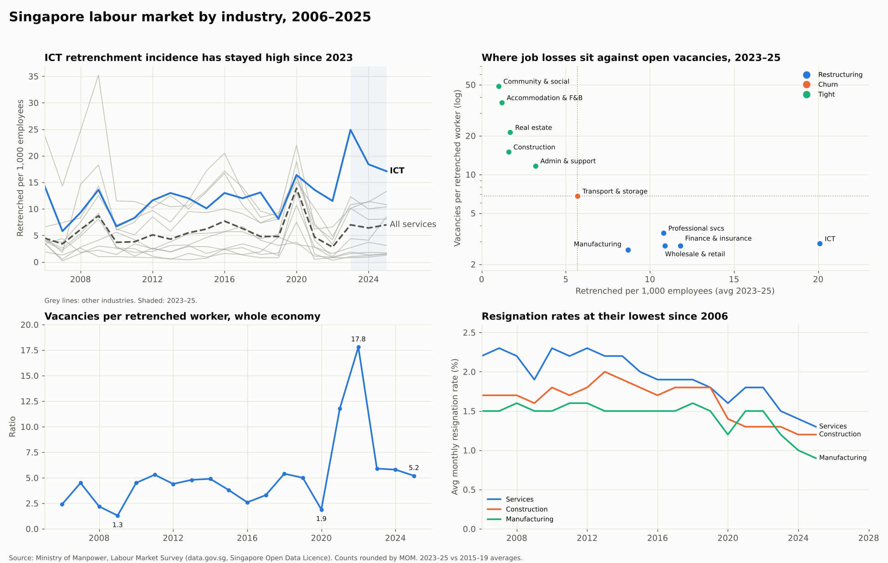

# Singapore Labour Market by Industry: Job Losses vs Job Openings, 2006–2025

Which industries are shedding jobs, which can't fill them, and how has that changed since before COVID-19?

This project merges four Ministry of Manpower (MOM) datasets from data.gov.sg (retrenchment incidence, retrenchment counts, job vacancies and resignation rates) into one industry × year model. It then compares the pre-COVID baseline (2015–19) with the latest three years (2023–25).

**Stack:** Python (pandas) · SQL (DuckDB) · star-schema data model · pytest · matplotlib



## Key findings

1. **ICT is now the highest-retrenchment industry.** It averaged 20.1 retrenchments per 1,000 employees in 2023–25, up from 11.3 in 2015–19 (peak 24.9 in 2023). Its share of all retrenchments rose from 6.3% to 16.0%.
2. **Job losses and openings sit in different industries.** ICT, finance and insurance, wholesale and retail, professional services and manufacturing combine above-median retrenchment with only 2.6–3.5 vacancies per retrenched worker. Community and social services (48.7), accommodation and F&B (36.3) and construction (15.0, up from 1.5) have many more openings than job losses.
3. **Economy-wide, there are more openings per job loss than before COVID.** The figure was 5.6 vacancies per retrenched worker in 2023–25, against 3.8 in 2015–19. It peaked at 17.8 in 2022 and was lowest in the 2009 (1.3) and 2020 (1.9) downturns.
4. **Resignations are at a 20-year low.** Every industry recorded its lowest monthly resignation rate of the series in 2025 (services 1.3%, manufacturing 0.9%).

A one-page write-up with implications and caveats is in [`docs/policy_note.md`](docs/policy_note.md).

## Data

| Measure | data.gov.sg dataset | Unit |
|---|---|---|
| Incidence of retrenchment by industry (annual) | `d_8ee93a4e261908fafe878ea0bec29817` | per 1,000 employees |
| Retrenched employees by industry (annual) | `d_661bf51b24d91dff23c053fc461c0923` | persons (rounded to 10) |
| Job vacancies by industry (annual) | `d_01966fdb498fa7fa2863635e25539693` | vacancies (rounded to 100) |
| Average monthly resignation rate by industry (annual) | `d_83f04fc0e00cb029000aa3bf8c5d0478` | % |

Source: Ministry of Manpower, Labour Market Survey, via data.gov.sg under the Singapore Open Data Licence. The scope is 2006–2025 (consistent SSIC breakdown) and 13 industries. Row counts and column totals of `data/raw/` were checked against the data.gov.sg API on 15 Nov 2026, and those totals are pinned in `tests/test_raw.py`.

## Pipeline

```
data/raw/*.csv (4 MOM sources, long format)
   │  src/checks.py: 26 data-quality rules (errors stop the run)
   ▼
DuckDB SQL models (sql/)
   ├── 01_stg_labour              stack sources, '-' → NULL
   ├── 02_dim_tables              dim_industry (with hierarchy), dim_year (periods)
   ├── 03_fct_industry_year       fused fact: industry × year, 4 measures + view
   ├── 04_mart_period_compare     2015–19 vs 2023–25 per industry
   ├── 05_mart_industry_segments  restructuring / churn / tight / stable
   └── 06_mart_economy_trend      whole-economy totals per year
   ▼
data/processed/*.csv → outputs/dashboard.png + outputs/charts/*.png
```

### Star schema

```
dim_industry ── fct_industry_year ── dim_year
```

`fct_industry_year` has one row per industry × year (260 rows). Tests check unique dimension keys, no orphan keys, the fact table reconciling to staging, and the whole-economy mart matching the Level-1 sum.

### Data-quality rules (`src/checks.py`)

| Rule | Severity |
|---|---|
| Known industries only, full industry × year grid, no duplicates (each source) | error |
| Values numeric or MOM's `-` only; non-negative | error |
| Incidence within 0–1,000 per 1,000; resignation rate within 0–100% | error |
| **Services reconciles to the sum of its 9 sub-industries**, within MOM rounding (retrenchments ±50, vacancies ±500) | error |
| Retrenchment count and incidence agree on nil years | error |
| `-` (nil/negligible) entries logged | warning |
| Year-on-year incidence swing over 10 per 1,000 | warning |

On the current data, all error rules pass. The warnings flag 2 nil entries (the "others" industry in 2010 and 2018) and 12 large swings, mostly the 2020 COVID spike and the 2008–10 global financial crisis.

## How to reproduce

```bash
pip install -r requirements.txt
python scripts/download_data.py   # optional: refresh from data.gov.sg
python -m src.pipeline            # checks + DuckDB models + processed CSVs
python -m src.charts              # charts and dashboard
python -m pytest                  # 14 tests
```

## Limitations

- Counts are rounded by MOM, so small industries are noisy.
- Vacancies are a June snapshot; retrenchments are annual. Vacancies per retrenched worker is a pressure indicator, not a job-matching rate.
- Industry-level data can't show whether an open job suits a retrenched worker. That would need occupation and skills data.
